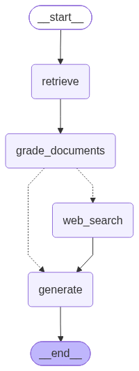

# Corrective RAG com LangGraph

Projeto de estudo de **Corrective RAG (CRAG)**: um pipeline RAG que não confia cegamente nos documentos recuperados — ele **avalia** a relevância de cada documento e, se necessário, **corrige** a recuperação fazendo busca na web.

## Visão geral do grafo



## Estrutura do projeto

```
├── main.py                     # entrypoint: invoca o grafo com uma pergunta
├── ingestion.py                # carrega URLs, divide em chunks e indexa no Chroma
├── graph/
│   ├── graph.py                # monta o StateGraph (nós + arestas + condicionais)
│   ├── state.py                # GraphState (TypedDict com o estado compartilhado)
│   ├── consts.py               # constantes com os nomes dos nós
│   ├── nodes/                  # nós do grafo (uma função por arquivo)
│   │   ├── retrieve.py
│   │   ├── grade_documents.py
│   │   ├── web_search.py
│   │   └── generate.py
│   └── chains/                 # chains LLM (prompt | llm | parser)
│       ├── retrieval_grader.py
│       ├── generation.py
│       └── tests/test_chain.py
└── .chroma_db/                 # banco vetorial persistido (Chroma)
```

## Como funciona, passo a passo

### 1. Ingestão (`ingestion.py`) — preparar a base de conhecimento

Antes de rodar o grafo, os documentos precisam estar no banco vetorial:

1. **Carrega** 3 artigos do blog da Lilian Weng com `WebBaseLoader`.
2. **Divide** em chunks com `RecursiveCharacterTextSplitter.from_tiktoken_encoder` (`chunk_size=200` tokens, sem overlap).
3. **Indexa** no Chroma com embeddings locais `HuggingFaceEmbeddings` (`all-MiniLM-L6-v2`), persistindo em `./.chroma_db`.

> ⚠️ O bloco `Chroma.from_documents(...)` está comentado no código. Para (re)criar a base, descomente e rode `ingestion.py` uma vez. O `Chroma(...)` logo abaixo apenas **abre** a coleção existente — ele não insere nada.

### 2. Estado do grafo (`graph/state.py`)

```python
class GraphState(TypedDict):
    question: str            # pergunta do usuário
    generation: str          # resposta do LLM
    web_search: bool         # flag: precisa buscar na web?
    documents: list[Document]
```

Todo nó recebe o estado e devolve só as chaves que quer atualizar — o LangGraph faz o merge.

### 3. Nó `retrieve` (`graph/nodes/retrieve.py`)

Pega `question` do estado e consulta o retriever do Chroma:

```python
docs = retriever.invoke(question)
```

Retorna `{"question": ..., "documents": docs}`.

### 4. Nó `grade_documents` (`graph/nodes/grade_documents.py`) — o "corretivo" do CRAG

Aqui está a diferença de um RAG simples:

- Para **cada documento** recuperado, chama a chain `retrieval_grader` (LLM com saída estruturada via `with_structured_output(GradeDocuments)`), que responde um score binário `yes`/`no`.
- Documentos com `yes` vão para `filtered_docs`.
- Se **qualquer** documento for rejeitado, levanta a flag `web_search = True`.

```python
score = retrieval_grader.invoke({"document": document.page_content, "question": question})
```

### 5. Aresta condicional (`graph/graph.py`)

```python
workflow.add_conditional_edges(
    GRADE_DOCUMENTS,
    should_continue,
    path_map={WEB_SEARCH: WEB_SEARCH, GENERATE: GENERATE}
)
```

- `web_search == True` → vai para o nó `web_search` (correção).
- `web_search == False` → vai direto para `generate`.

### 6. Nó `web_search` (`graph/nodes/web_search.py`)

Busca na web com **Tavily** (`max_results=3`), junta os conteúdos dos resultados e os converte em um `Document` — porque o `GraphState` espera `list[Document]`. Esse documento da web é **anexado** à lista de documentos existente.

### 7. Nó `generate` (`graph/nodes/generate.py`)

Chama a `generation_chain` com a pergunta e todos os documentos sobreviventes:

```python
generation = generation_chain.invoke({"question": question, "context": documents})
```

### 8. Chains LLM (`graph/chains/`)

- **`retrieval_grader.py`** — prompt de grader + `llm.with_structured_output(GradeDocuments)` para forçar a resposta `{"binary_score": "yes"|"no"}`.
- **`generation.py`** — prompt clássico de RAG ("Use the following pieces of retrieved context...") com `StrOutputParser`.

Ambas usam o modelo `z-ai/glm-5.3-flash` via `langchain-openrouter`.

### 9. Entrypoint (`main.py`)

```python
app = workflow.compile()
print(app.invoke({"question": "What is agent memory?"}))
```

## Como usar

### 1. Instalar dependências

```bash
uv sync
```

### 2. Configurar as variáveis de ambiente

Crie um arquivo `.env` na raiz:

```
OPEN_ROUTER_API_KEY=sua-chave-do-openrouter
TAVILY_API_KEY=sua-chave-do-tavily
```

A Tavily só é usada quando o grader rejeita algum documento; a OpenRouter, em todas as chains.

### 3. Fazer a ingestão (uma vez)

Descomente o bloco `Chroma.from_documents(...)` em `ingestion.py` e rode:

```bash
uv run ingestion.py
```

Depois comente novamente (ou crie um `if __name__ == "__main__":` para o bloco), para não reindexar a cada import.

### 4. Rodar o grafo

```bash
uv run main.py
```

Saída esperada:

```python
{'question': 'What is agent memory?', 'generation': '...', 'web_search': False, 'documents': [...]}
```

### 10. `__all__` no `graph/nodes/__init__.py`

```python
from graph.nodes.grade_documents import grade_documents
from graph.nodes.web_search import web_search
from graph.nodes.retrieve import retrieve
from graph.nodes.generate import generate

__all__ = ["grade_documents", "web_search", "retrieve", "generate"]
```

O `__init__.py` re-exporta os nós para que `graph/graph.py` possa fazer `from graph.nodes import web_search, retrieve, ...` sem importar cada subarquivo. O `__all__` é a **lista explícita do que o pacote expõe** quando alguém faz `from graph.nodes import *`:

- Controla o que entra no namespace e documenta a "API pública" do pacote.
- Serve de trava contra bugs de colisão de nome: se o módulo `retrieve.py` importa o retriever do Chroma (`from ingestion import retriever`), o `__all__` garante que só a função `retrieve` seja considerada pública — e o import do `retriever` (errado) não passe despercebido.
- É só uma convenção/lista: se você importar `retriever` diretamente (`from graph.nodes.retrieve import retriever`), ele continua acessível — o `__all__` não esconde nada.

## Notas de aprendizado

- **`documents` vs `context`**: o estado do grafo usa `documents` (lista de `Document`s); o prompt da generation chain usa o placeholder `{context}`. A regra é única: a chave do dict no `.invoke()` precisa bater com o nome da variável entre `{}` no template. O nó é quem faz a ponte entre os dois nomes.
- **Grader no singular**: `retrieval_grader` avalia um documento por vez (`{document}`), por isso o nó `grade_documents` faz um loop.
- **`from_tiktoken_encoder`**: o splitter mede os chunks em tokens (via tiktoken), não em caracteres.
- O PNG do grafo (`graph/graph.png`) é gerado automaticamente por `graph/graph.py` ao importar: `app.get_graph().draw_mermaid_png(...)`.
